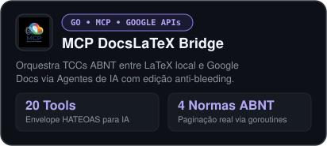
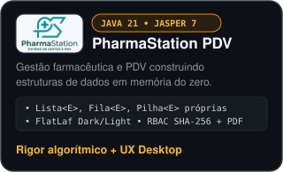
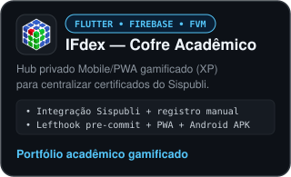
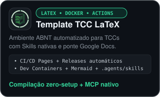
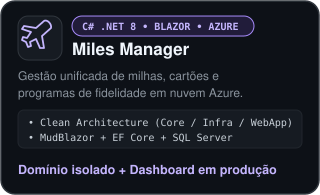
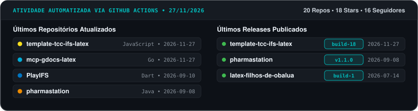

  

   

  
  
<i>Combinando a robustez do <b>Java/C#</b> com a performance do <b>Go</b> e a agilidade do <b>TypeScript/React/Flutter</b>.</i>

  

    
  

---

## Projetos em Destaque

Clique em qualquer card para abrir o projeto, ou expanda abaixo de cada um para ver o motivo e os ganhos:

<table>
  <tr>
    <td colspan="6" align="center" valign="top">
      
      

        
<b>Ver motivo, arquitetura e ganhos</b>

        

          <b>Por que foi feito:</b> Analisadores comuns (como Pandas) carregam arquivos inteiros em RAM, causando <i>Out-Of-Memory</i> em servidores de baixo custo. 
          <b>Solução &amp; Engenharia:</b> Pipeline <i>Producer-Consumer</i> em Go com <code>sync.Pool</code> (zero-allocation), sniffer automático de encoding/separador, progresso via SSE e frontend React embutido via <code>//go:embed</code>. 
          <b>Ganhos Reais:</b> Processa <b>10 GB (~120M linhas)</b> em container limitado a <b>512 MB de RAM</b> mantendo pico de apenas <b>~12 MB de Heap</b> (O(1)) e detecção nativa de padrões BR (CNPJ, CPF, NFe, Placas, CEP). 
          <b>Acessos extras:</b> <a href="https://dataprofiler-jgustavocn.onrender.com" target="_blank" rel="noopener noreferrer">Live Demo</a> • <a href="https://jgustavocn.github.io/dataprofiler/" target="_blank" rel="noopener noreferrer">Documentação</a>
        

      

    </td>
  </tr>
  <tr>
    <td colspan="6" align="center" valign="top">
      
      

        
<b>Ver motivo, arquitetura e ganhos</b>

        

          <b>Por que foi feito:</b> Padronizar a elaboração de simulados/provas diagramadas em A4 e a prestação de contas de monitoria do programa federal Partiu IF (MEC/Secadi/IFS). 
          <b>Solução &amp; Engenharia:</b> Plataforma Next.js 16 + Supabase com fluxo editorial travado por máquina de estados, editor KaTeX/MathLive e servidor MCP v2 integrado (<code>mcp-use</code> + OAuth 2.1 PKCE + PostgreSQL RLS). 
          <b>Ganhos Reais:</b> Busca semântica em <b>12.800 habilidades BNCC</b>, preview interativo de folha A4 dentro do Claude/ChatGPT (SEP-1865), controle RBAC com 5 perfis e <b>340+ testes automatizados</b> em Vitest. <i>(Repositório institucional privado)</i> 
          <b>Acessos extras:</b> <a href="https://base-apoio-partiuif.vercel.app/conectar-ia" target="_blank" rel="noopener noreferrer">Conectar IA (MCP)</a>
        

      

    </td>
  </tr>
  <tr>
    <td colspan="3" width="50%" align="center" valign="top">
      
      

        
<b>Ver motivo e ganhos</b>

        

          <b>Por quê:</b> Orientadores revisam no Google Docs enquanto autores escrevem em LaTeX local, gerando retrabalho manual e quebra de normas. 
          <b>Ganhos:</b> <b>20 tools HATEOAS</b> em binário Go único (zero Python/Node), diff em 3 níveis, edição atômica anti-bleeding, paginação real via goroutines e auditoria ABNT (NBR 14724/6023/6024/6027). 
          <b>Extra:</b> <a href="https://github.com/JGustavoCN/mcp-gdocs-latex/releases" target="_blank" rel="noopener noreferrer">Binários (Releases)</a>
        

      

    </td>
    <td colspan="3" width="50%" align="center" valign="top">
      
      

        
<b>Ver motivo e ganhos</b>

        

          <b>Por quê:</b> O sistema legado institucional trafegava em HTTP puro e expunha o CPF do estudante diretamente nas URLs de certificados e logs. 
          <b>Ganhos:</b> Proxy <i>Security-First</i> em FastAPI com <b>URL Ticket Proxy</b> (tickets efêmeros Fernet), PII Redactor em logs, Edge Cache de 24h e <b>91% de cobertura de testes</b> (Pytest/VCR/E2E). 
          <b>Extra:</b> <a href="https://sispubli-api.vercel.app/docs" target="_blank" rel="noopener noreferrer">Swagger API</a>
        

      

    </td>
  </tr>
  <tr>
    <td colspan="2" width="33.3%" align="center" valign="top">
      
      

        
<b>Ver motivo e ganhos</b>

        

          <b>Por quê:</b> Extravio de vagas e furos de fila em listas de transporte universitário no WhatsApp. 
          <b>Ganhos:</b> Parser estatístico lê milhares de linhas <code>.txt</code>, gera prova comparativa lado a lado e relatórios via hash (<code>/report/[hash]</code>). <a href="https://aeutb-auditor.vercel.app" target="_blank" rel="noopener noreferrer">App</a>
        

      

    </td>
    <td colspan="2" width="33.3%" align="center" valign="top">
      
      

        
<b>Ver motivo e ganhos</b>

        

          <b>Por quê:</b> Competições do IFS dependiam de planilhas manuais propensas a erros. 
          <b>Ganhos:</b> Sorteio balanceado, mata-mata automático (W.O. e <i>byes</i>), súmula em lote e <b>16 manuais de engenharia</b> (Java 21 + Spring Boot + Flutter).
        

      

    </td>
    <td colspan="2" width="33.3%" align="center" valign="top">
      
      

        
<b>Ver motivo e ganhos</b>

        

          <b>Por quê:</b> Aplicar Estruturas de Dados puras em um PDV desktop de alto acabamento visual. 
          <b>Ganhos:</b> <b>Lista, Fila e Pilha do zero</b> (sem <code>java.util.List</code>), UI Dark/Light com FlatLaf, RBAC SHA-256 e PDFs em JasperReports 7.0. <a href="https://github.com/JGustavoCN/pharmastation/releases/latest" target="_blank" rel="noopener noreferrer">Release</a>
        

      

    </td>
  </tr>
</table>

<strong>Explorar mais projetos próprios (Mobile, Automação LaTeX e .NET Clean Architecture)</strong>

 

<table>
  <tr>
    <td width="33.3%" align="center" valign="top">
      
      

        
<b>Ver motivo e ganhos</b>

        

          <b>Por quê:</b> Estudantes perdem certificados espalhados entre sistemas e pastas. 
          <b>Ganhos:</b> App híbrido Flutter (Android/PWA) integrado ao Sispubli com sistema de XP, FVM e Lefthook. <a href="https://ifdex-app.firebaseapp.com/" target="_blank" rel="noopener noreferrer">PWA</a>
        

      

    </td>
    <td width="33.3%" align="center" valign="top">
      
      

        
<b>Ver motivo e ganhos</b>

        

          <b>Por quê:</b> Eliminar barreiras de configuração de ambiente LaTeX ABNT. 
          <b>Ganhos:</b> Compilação na nuvem (GitHub Pages/Releases a cada push), Dev Containers e <code>.agents/skills/</code> compatível com o <code>mcp-gdocs-latex</code>. <a href="https://jgustavocn.github.io/template-tcc-ifs-latex/" target="_blank" rel="noopener noreferrer">PDF</a>
        

      

    </td>
    <td width="33.3%" align="center" valign="top">
      
      

        
<b>Ver motivo e ganhos</b>

        

          <b>Por quê:</b> Centralizar cálculo de pontos dispersos entre cartões e programas de fidelidade. 
          <b>Ganhos:</b> Clean Architecture (Core, Infrastructure e WebApp) em .NET 8, Blazor Server, MudBlazor, EF Core + SQL Server. <a href="https://miles-manager-app-jgustavocn-acbhhhavcgchgsgk.eastus-01.azurewebsites.net/" target="_blank" rel="noopener noreferrer">Azure</a>
        

      

    </td>
  </tr>
</table>

---

## Arsenal Técnico

  

 

<strong>Ver stack complementar, testes e infraestrutura</strong>

 

<table>
  <tr>
    <th align="left">Domínio</th>
    <th align="left">Tecnologias &amp; Ferramentas</th>
  </tr>
  <tr>
    <td><b>Linguagens &amp; UI</b></td>
    <td><code>TypeScript</code> <code>JavaScript</code> <code>PowerShell</code> <code>Blazor</code> <code>MudBlazor</code> <code>Material UI</code> <code>Tailwind v4</code> <code>Vite</code> <code>SWC</code></td>
  </tr>
  <tr>
    <td><b>Backend &amp; IA</b></td>
    <td><code>FastAPI</code> <code>Spring Security</code> <code>Hibernate</code> <code>EF Core</code> <code>Node.js</code> <code>MCP (mcp-use)</code> <code>OAuth 2.1</code></td>
  </tr>
  <tr>
    <td><b>Testes &amp; Qualidade</b></td>
    <td><code>Pytest (VCR/E2E)</code> <code>Vitest</code> <code>JUnit 5</code> <code>Ruff</code> <code>Apache JMeter</code> <code>Lefthook</code></td>
  </tr>
  <tr>
    <td><b>Dados &amp; Cloud</b></td>
    <td><code>Supabase (RLS)</code> <code>SQL Server</code> <code>MySQL</code> <code>Oracle</code> <code>MongoDB</code> <code>GitHub Actions</code> <code>Vercel</code> <code>Render</code> <code>Azure</code></td>
  </tr>
</table>

---

## Atividade &amp; Releases Recentes

  

<b>Abrir links diretos dos repositórios e releases recentes</b>

 

<table>
  <tr>
    <td width="50%" valign="top">
      <strong>Últimos Repositórios Atualizados</strong>  
      <!-- recent_updates starts -->
• <a href="https://github.com/JGustavoCN/template-tcc-ifs-latex"><b>template-tcc-ifs-latex</b></a> (JavaScript • 2026-11-25) • <a href="https://github.com/JGustavoCN/mcp-gdocs-latex"><b>mcp-gdocs-latex</b></a> (Go • 2026-11-23) • <a href="https://github.com/JGustavoCN/PlayIFS"><b>PlayIFS</b></a> (Dart • 2026-09-10) • <a href="https://github.com/JGustavoCN/pharmastation"><b>pharmastation</b></a> (Java • 2026-09-08)
<!-- recent_updates ends -->
    </td>
    <td width="50%" valign="top">
      <strong>Últimos Releases Publicados</strong>  
      <!-- recent_releases starts -->
• <a href="https://github.com/JGustavoCN/template-tcc-ifs-latex/releases/tag/build-17"><b>template-tcc-ifs-latex</b> <code>build-17</code></a> (2026-11-25) • <a href="https://github.com/JGustavoCN/pharmastation/releases/tag/v1.1.0"><b>pharmastation</b> <code>v1.1.0</code></a> (2026-09-08) • <a href="https://github.com/JGustavoCN/latex-filhos-de-obaluaie/releases/tag/build-1"><b>latex-filhos-de-obaluaie</b> <code>build-1</code></a> (2026-07-14)
<!-- recent_releases ends -->
    </td>
  </tr>
</table>

---

## GitHub Stats

   
  

 

  

 

---

  <picture>
    <source media="(prefers-color-scheme: dark)" srcset="https://raw.githubusercontent.com/JGustavoCN/JGustavoCN/output/github-contribution-grid-snake-dark.svg" />
    <source media="(prefers-color-scheme: light)" srcset="https://raw.githubusercontent.com/JGustavoCN/JGustavoCN/output/github-contribution-grid-snake.svg" />
    
  </picture>

