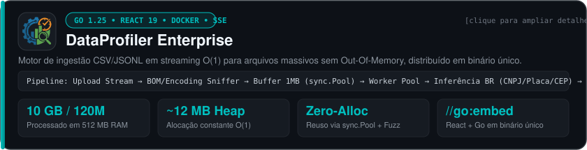
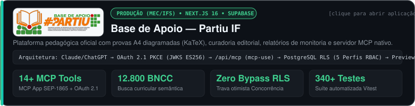
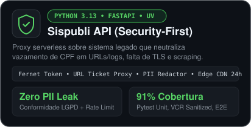
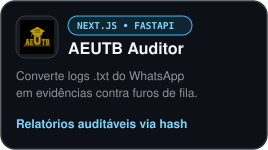
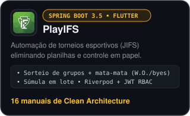

  
  
<i>Combinando a robustez do <b>Java/C#</b> com a performance do <b>Go</b> e a agilidade do <b>React/Flutter</b>.</i>

---

## Projetos em Destaque

<table>
  <tr>
    <td colspan="6" align="center">
      
    </td>
  </tr>
  <tr>
    <td colspan="6" align="center">
      
    </td>
  </tr>
  <tr>
    <td colspan="3" width="50%" align="center">
      
    </td>
    <td colspan="3" width="50%" align="center">
      
    </td>
  </tr>
  <tr>
    <td colspan="2" width="33.3%" align="center">
      
    </td>
    <td colspan="2" width="33.3%" align="center">
      
    </td>
    <td colspan="2" width="33.3%" align="center">
      
    </td>
  </tr>
</table>

<strong>Outros projetos, demos ao vivo e documentações</strong>

 

<table>
  <tr>
    <th align="left">Projeto</th>
    <th align="left">Stack &amp; Entrega</th>
    <th align="left">Acesso</th>
  </tr>
  <tr>
    <td><strong>IFdex</strong></td>
    <td>Flutter + Firebase • Cofre acadêmico gamificado (XP) integrável ao Sispubli</td>
    <td><a href="https://github.com/JGustavoCN/ifdex">Repositório</a> • <a href="https://ifdex-app.firebaseapp.com/">App</a></td>
  </tr>
  <tr>
    <td><strong>Template TCC IFS LaTeX</strong></td>
    <td>LaTeX ABNT + Docker + CI/CD • Compilação automática e Skills para Agentes de IA</td>
    <td><a href="https://github.com/JGustavoCN/template-tcc-ifs-latex">Repositório</a> • <a href="https://jgustavocn.github.io/template-tcc-ifs-latex/">PDF Público</a></td>
  </tr>
  <tr>
    <td><strong>Miles Manager</strong></td>
    <td>C# (.NET 8) + Blazor + MudBlazor • Clean Architecture (Onion) com SQL Server</td>
    <td><a href="https://github.com/JGustavoCN/miles-manager">Repositório</a> • <a href="https://miles-manager-app-jgustavocn-acbhhhavcgchgsgk.eastus-01.azurewebsites.net/">Azure</a></td>
  </tr>
</table>

**Links diretos (Demos &amp; Docs dos cards acima):**
[DataProfiler Demo](https://dataprofiler-jgustavocn.onrender.com) / [Docs](https://jgustavocn.github.io/dataprofiler/) • [Base Partiu IF](https://base-apoio-partiuif.vercel.app) / [Conectar IA](https://base-apoio-partiuif.vercel.app/conectar-ia) • [Sispubli Swagger](https://sispubli-api.vercel.app/docs) • [AEUTB App](https://aeutb-auditor.vercel.app) • [PharmaStation Release](https://github.com/JGustavoCN/pharmastation/releases/latest)

---

## Arsenal Técnico

  

 

<strong>Ver stack complementar, testes e infraestrutura</strong>

- **Linguagens & Web:** JavaScript, PowerShell, Blazor, MudBlazor, Material UI, Tailwind CSS, Vite, SWC
- **Backend & IA:** FastAPI, Spring Boot, Spring Security, Hibernate, Entity Framework Core, Node.js, Model Context Protocol (`mcp-use`)
- **Qualidade & Testes:** Pytest (VCR/E2E), Vitest, JUnit 5, Ruff, Apache JMeter
- **Bancos de Dados:** PostgreSQL (Supabase + RLS), SQL Server, MySQL, MariaDB, Oracle, MongoDB
- **Cloud & DevOps:** Docker, GitHub Actions, Vercel, Render, Azure, AWS, Linux

---

## GitHub Stats

   
  

 

  

 

---

  <picture>
    <source media="(prefers-color-scheme: dark)" srcset="https://raw.githubusercontent.com/JGustavoCN/JGustavoCN/output/github-contribution-grid-snake-dark.svg" />
    <source media="(prefers-color-scheme: light)" srcset="https://raw.githubusercontent.com/JGustavoCN/JGustavoCN/output/github-contribution-grid-snake.svg" />
    
  </picture>

